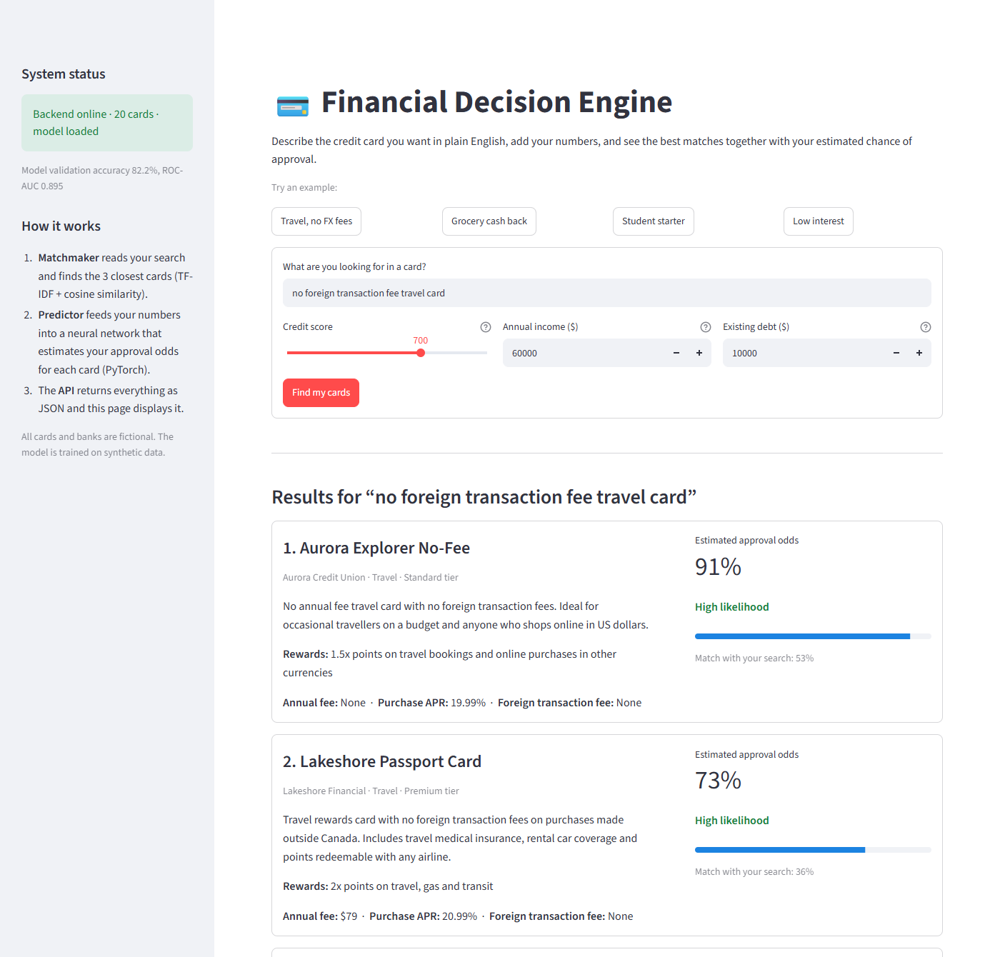
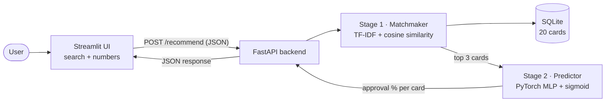
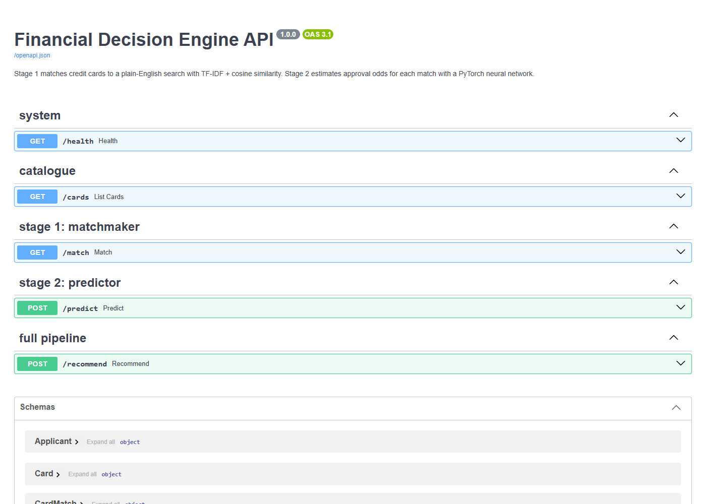

# 💳 Financial Decision Engine

**This is a full-stack machine learning web app that finds the credit cards that match what you want, then predicts your probability of being approved for each one.**

[](https://github.com/harrepk/Financial-Decision-Engine/actions/workflows/ci.yml)




---

## Why I Built This

Choosing a credit card can typically be confusing for most. There are hundreds of options, and banks
don't explain how they decide who gets approved, so many people apply blindly.
In Canada, each application can leave a hard inquiry on your credit report, so
a rejection costs more than just disappointment.

This project turns that guesswork into two clear answers:

1. **Which cards actually fit what I care about?** You describe it in plain English.
2. **How likely am I to be approved for each one?** You see a percentage before you apply.

It is built the way production ML systems are built: a frontend that only handles
the user experience, a backend API that owns the data and the models, and models
trained offline and served from a saved artifact.

## Features

- **Card search.** Type *"no foreign transaction fee travel card"*
  and get the three closest matches, ranked by TF-IDF + cosine similarity.
- **Per-card approval odds.** A PyTorch neural network scores every match from your
  credit score, income and debt, plus how demanding each card is.
- **Plain-language insights.** Debt-to-income ratio, credit score context and income
  guideline warnings, so the number isn't a black box.
- **Clean REST API** with automatic validation and interactive docs at `/docs`.
- **35 automated tests** covering the database, search, model and every API endpoint,
  plus a GitHub Actions CI workflow that lints (ruff) and tests every push.
- **Honest evaluation.** The neural network is benchmarked against a logistic
  regression baseline on held-out data.

## How it Works



| Stage | What it Does | Tech |
|---|---|---|
| **1 · The Matchmaker** | Turns your search and every card's description into TF-IDF vectors, then ranks cards by cosine similarity. Keeps "no" as a meaningful word, merges plurals, and uses two-word phrases. Returns nothing (with a helpful hint) if no card is relevant. | scikit-learn, SQLite |
| **2 · The Predictor** | Builds a `[3, 4]` tensor (3 cards × 4 features: credit score, log income, log debt, card tier), runs a 4 → 32 → 16 → 1 MLP, and applies a sigmoid to get a probability for each card in one batched pass. | PyTorch |
| **3 · The API & UI** | FastAPI validates inputs with Pydantic, loads both models **once** at startup, and returns structured JSON. Streamlit renders it and keeps results in `st.session_state` across reruns. | FastAPI, Pydantic, Streamlit |

📐 **Full diagrams** (component view, sequence diagram, per-stage flowcharts, data
model, training pipeline): [docs/ARCHITECTURE.md](docs/ARCHITECTURE.md)
📖 **Plain-English explanation**: [docs/HOW_IT_WORKS.md](docs/HOW_IT_WORKS.md)

## Model Results

Trained on 4,000 synthetic applications and evaluated on 1,000 held-out ones:

| Model | Validation accuracy | Validation ROC-AUC |
|---|---|---|
| **PyTorch MLP** (this project) | **82.2%** | **0.895** |
| Logistic regression baseline | 78.8% | 0.873 |

The network wins because the hidden lending rules are non-linear (for example,
premium cards are almost never approved for subprime credit scores, and debt
matters *relative to* income), which a linear model can't fully capture. Sanity
tests also confirm the model learned sensible directions: higher score ↑, more debt ↓,
higher income ↑, more premium card ↓.

> **About the data:** real approval data is private, so `ml/generate_data.py`
> simulates applicants with a hidden, lender-style policy plus randomness. The model
> never sees that policy; it has to learn it from examples. See the
> [walkthrough notebook](notebooks/model_walkthrough.ipynb) for the data exploration.

## Tech Stack

| Layer | Technology | Why |
|---|---|---|
| Frontend | **Streamlit** | Interactive Python UI without HTML/CSS/JS |
| Backend | **FastAPI** + **Pydantic** + **Uvicorn** | Fast, typed REST API with automatic validation and docs |
| Database | **SQLite** | Real relational database in a single file, zero setup |
| Search / NLP | **scikit-learn** (TF-IDF, cosine similarity) | Fast, explainable text matching |
| Deep learning | **PyTorch** (MLP, BCEWithLogitsLoss, Adam) | Probability scoring served from a `.pt` artifact |
| Testing / CI | **pytest**, FastAPI `TestClient`, **ruff**, **GitHub Actions** | Automated lint + tests on every push |

## Quickstart

**Requirements:** Python 3.10+ (tested on Python 3.12, Windows 11).

```bash
git clone https://github.com/harrepk/Financial-Decision-Engine.git
cd Financial-Decision-Engine

python -m venv .venv
# Windows (PowerShell):   .venv\Scripts\Activate.ps1
# macOS / Linux:          source .venv/bin/activate

pip install -r requirements.txt
```

A trained model (`models/approval_mlp.pt`, ~7 KB) is included, so you can run the
app straight away. Use **two terminals** (both with the virtual environment active):

```bash
# Terminal 1: backend API on http://localhost:8000  (docs at /docs)
uvicorn backend.main:app --reload --port 8000

# Terminal 2: frontend on http://localhost:8501
streamlit run frontend/app.py
```

Other useful commands:

```bash
python -m ml.train          # retrain the model (under a minute on a laptop CPU)
python -m ml.generate_data  # export the synthetic dataset to data/synthetic_applications.csv
pytest                      # run all 35 tests
ruff check .                # lint
```

> **Windows tip:** if PowerShell refuses to run `Activate.ps1`, either run
> `Set-ExecutionPolicy -Scope CurrentUser RemoteSigned` once, or skip activation and
> call `.venv\Scripts\python -m uvicorn ...` / `.venv\Scripts\python -m streamlit ...` directly.

## API Reference

| Method | Endpoint | Purpose |
|---|---|---|
| `GET` | `/health` | Status, number of cards, whether the model is loaded, model metrics |
| `GET` | `/cards` | The full card catalogue |
| `GET` | `/match?query=...&top_k=3` | **Stage 1 only:** rank cards for a search |
| `POST` | `/predict` | **Stage 2 only:** approval odds for given card ids |
| `POST` | `/recommend` | **Full pipeline:** Stage 1 → Stage 2 → insights (used by the UI) |

Example request:

```bash
curl -X POST http://localhost:8000/recommend \
  -H "Content-Type: application/json" \
  -d '{"query": "no foreign transaction fee travel card", "credit_score": 720, "annual_income": 65000, "existing_debt": 8000}'
```

Example response (trimmed):

```json
{
  "query": "no foreign transaction fee travel card",
  "applicant": { "credit_score": 720, "annual_income": 65000.0, "existing_debt": 8000.0 },
  "debt_to_income": 0.1231,
  "recommendations": [
    {
      "card": { "id": 3, "name": "Aurora Explorer No-Fee", "category": "travel", "tier": 1, "annual_fee": 0.0, "foreign_transaction_fee": 0.0 },
      "match_score": 0.5288,
      "approval_probability": 0.948,
      "approval_band": "High",
      "meets_income_guideline": true
    }
  ],
  "insights": [
    "Your debt is 12% of your yearly income. Lenders generally see that as low and healthy.",
    "A score of 700 or more is generally considered good to excellent by Canadian lenders."
  ],
  "message": "Found 3 matching card(s).",
  "disclaimer": "Educational project. ..."
}
```

Invalid inputs (credit score outside 300–900, income ≤ 0, negative debt) return
**HTTP 422** with a field-by-field explanation. If the model hasn't been trained, the
prediction endpoints return **HTTP 503** with the command to fix it.

<details>
<summary>Screenshot of the interactive API docs (<code>/docs</code>)</summary>



</details>

## Project Structure

```
financial-decision-engine/
├── backend/
│   ├── main.py          # FastAPI app factory, routes, startup (lifespan) loading
│   ├── schemas.py       # Pydantic request/response models (input validation)
│   ├── database.py      # SQLite schema, seeding, parameterised queries
│   ├── matcher.py       # Stage 1: TF-IDF + cosine similarity search
│   ├── predictor.py     # Stage 2: loads the .pt model, batched inference
│   ├── model.py         # ApprovalMLP + build_features(), shared by training and serving
│   └── config.py        # paths (overridable by env vars) and thresholds
├── frontend/
│   └── app.py           # Streamlit UI
├── ml/
│   ├── generate_data.py # synthetic application generator
│   └── train.py         # training loop, early stopping, baseline comparison
├── data/
│   └── credit_cards.json  # 20 fictional cards (seeded into SQLite on first run)
├── models/
│   ├── approval_mlp.pt            # trained model artifact
│   └── approval_mlp.metrics.json  # its validation metrics
├── notebooks/
│   └── model_walkthrough.ipynb    # data exploration + "what if?" analysis
├── tests/               # 35 pytest tests (database, matcher, model, API)
├── docs/                # architecture diagrams, plain-English guide, screenshots
├── .github/workflows/ci.yml       # lint + tests on every push
├── .streamlit/config.toml         # UI settings
├── pyproject.toml                 # project metadata, pytest and ruff config
└── requirements.txt
```

## Engineering Challenges Solved

| Challenge | What goes wrong | How it's handled |
|---|---|---|
| **Tensor shapes** | One applicant's features are 1D `[4]`, but `nn.Linear` expects 2D `[batch, features]`. | `ApprovalPredictor.to_tensor()` adds the batch dimension and rejects the wrong feature count with a clear error. All matched cards are scored together as one `[3, 4]` batch. |
| **Same odds for every card** | With only applicant features, all 3 matches would get an identical probability. | Card tier is a model input, so each card gets its own realistic probability. |
| **Training/serving skew** | Features prepared one way in training and another in production silently ruin predictions. | One shared `build_features()` function; normalisation stats are stored *inside* the model file. |
| **Slow requests** | Loading models inside each request adds big delays. | FastAPI `lifespan` loads the database, TF-IDF index and network once at startup. |
| **Streamlit reruns** | Streamlit re-executes the whole script on every click, wiping results. | The API response lives in `st.session_state`; toggling the JSON view keeps the results. |
| **Two servers, two ports** | The UI must call the right backend address. | Configurable via `FDE_API_URL`; defaults to `127.0.0.1:8000` because on Windows `localhost` tries IPv6 first and adds ~0.25 s per call. |
| **Unsafe model loading** | Pickled `.pt` files can execute code when loaded. | `torch.load(..., weights_only=True)`. |
| **SQL injection** | String-built SQL queries are exploitable. | All queries are parameterised. |
| **Finance-specific NLP** | Standard stop-word lists drop "no", so "no annual fee" matches "annual fee". | Custom analyzer keeps "no", adds bigrams and light stemming. |

## Limitations and Responsible Use

- **Synthetic data, fictional cards.** Percentages demonstrate the technique; they are
  not real lender decisions and this is **not financial advice**.
- A real system would need real, fairly sourced data, **bias and fairness testing**
  across demographic groups, probability calibration checks, and regulatory review.
- TF-IDF matches words, not meaning: "abroad" won't match "international" unless both
  appear. Sentence embeddings would fix this (see roadmap).

## Roadmap

- [ ] Semantic search with sentence embeddings (e.g. `sentence-transformers`) instead of TF-IDF
- [ ] Explain each prediction (feature attributions / SHAP) in the UI
- [ ] Probability calibration plot and fairness report in the notebook
- [ ] Docker Compose for one-command startup, then deploy (e.g. Render + Streamlit Community Cloud)
- [ ] Larger card catalogue and filters (annual fee cap, card network)

## Author

**Harre Prakash Kumar** ([@harrepk](https://github.com/harrepk)), Computer Engineering, Toronto Metropolitan University (TMU)

## License

[MIT](LICENSE) © 2026 Harre Prakash Kumar
