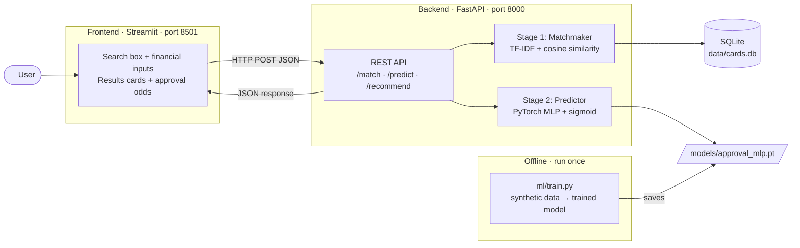
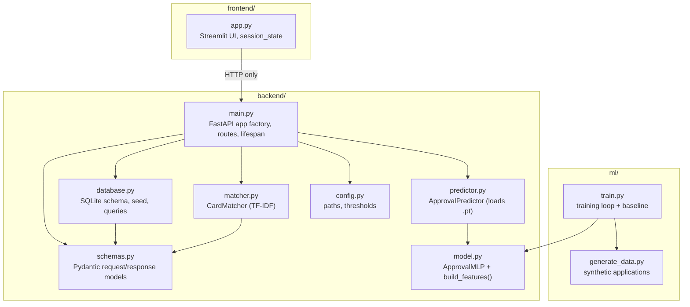
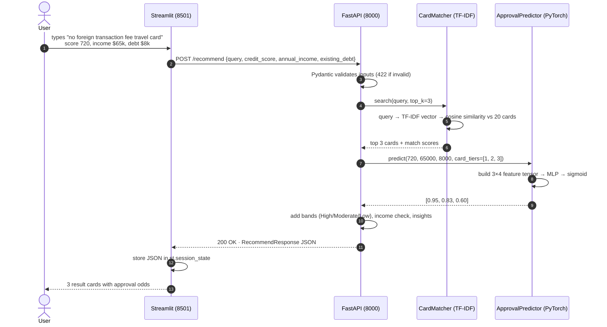
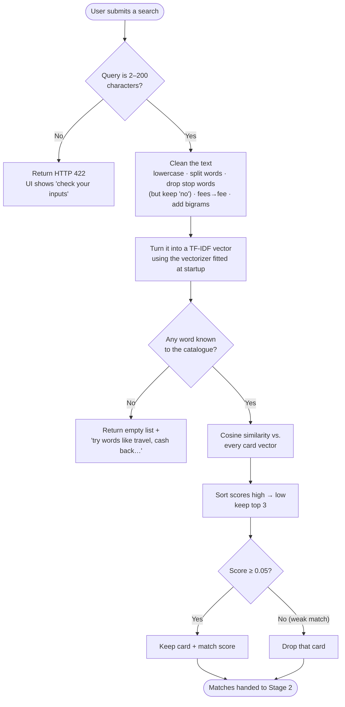
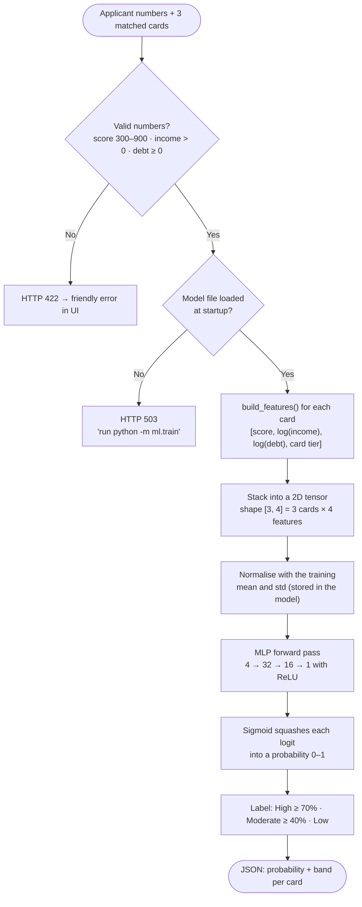
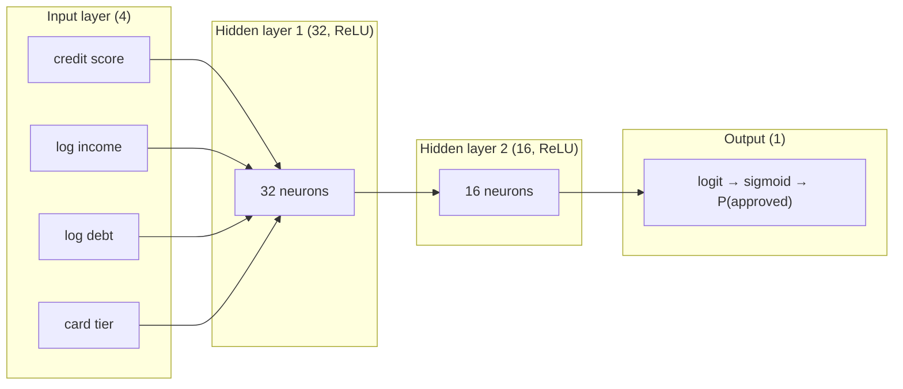
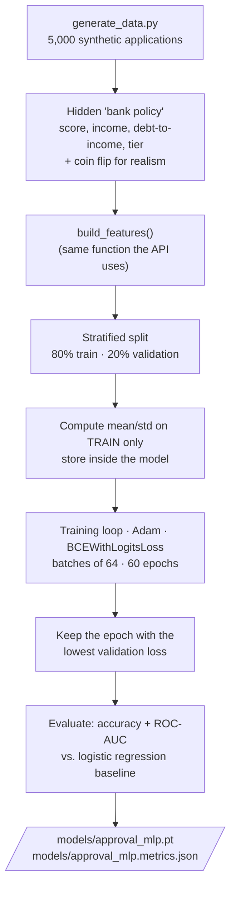
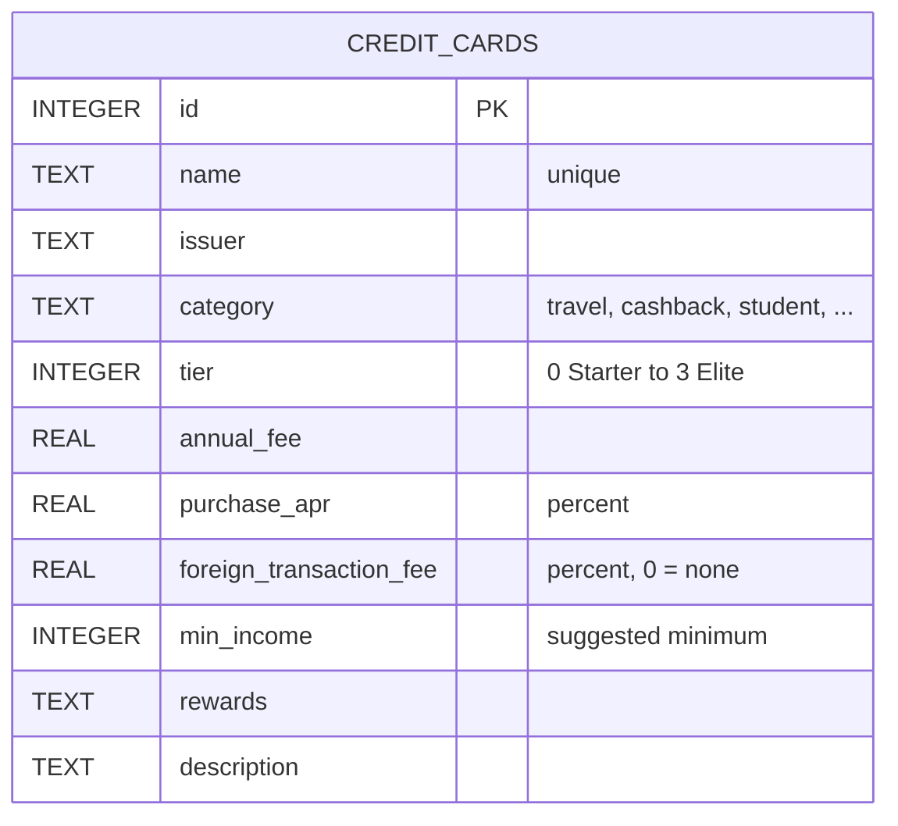
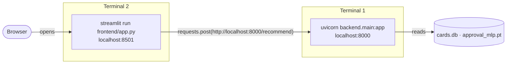
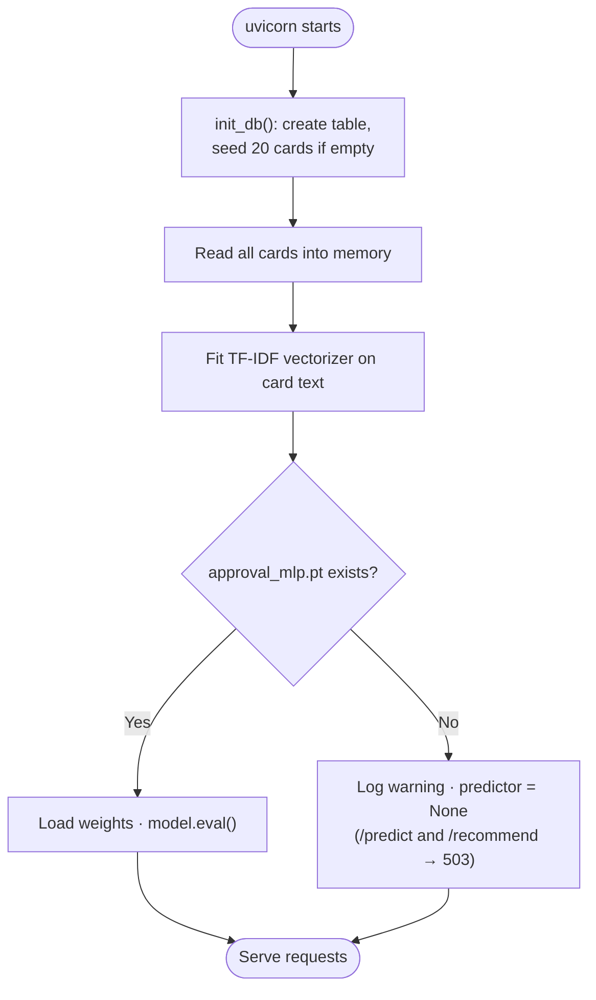

# Architecture

This document shows the Financial Decision Engine from several angles: the big
picture first, then each stage in depth. Every diagram is written in
[Mermaid](https://mermaid.js.org/), which GitHub renders automatically.

- [1. System overview](#1-system-overview)
- [2. Component view](#2-component-view)
- [3. Request lifecycle: one search, end to end](#3-request-lifecycle-one-search-end-to-end)
- [4. Stage 1: The Matchmaker](#4-stage-1-the-matchmaker)
- [5. Stage 2: The Predictor](#5-stage-2-the-predictor)
- [6. Offline training pipeline](#6-offline-training-pipeline)
- [7. Data model](#7-data-model)
- [8. Runtime view: processes and ports](#8-runtime-view-processes-and-ports)
- [9. Startup lifecycle](#9-startup-lifecycle)
- [10. Design decisions](#10-design-decisions)

---

## 1. System overview

The user talks to a Streamlit web page. The page talks to a FastAPI server. The
server owns the database and both ML models. Training happens offline, ahead of time.

## 2. Component view

Each box is a Python module. Arrows mean "imports / calls".

> `model.py` is shared by training **and** serving. The exact same `build_features()`
> function prepares numbers in both places, which prevents training/serving skew.

## 3. Request lifecycle: one search, end to end

What happens when the user clicks **Find my cards**:

## 4. Stage 1: The Matchmaker

**Goal:** turn a plain-English wish into the three most relevant cards.

How a card becomes searchable text (`card_document()` in `matcher.py`):

| Source field | Example | Why |
|---|---|---|
| name | "Lakeshore Passport Card" | users sometimes search by name |
| category tag | "travel" | strong signal of purpose |
| derived tags | "no foreign transaction fee", "no annual fee", "low interest rate" | turns numeric columns into searchable words |
| rewards | "2x points on travel, gas and transit" | what the user earns |
| description | full marketing text | everything else |

## 5. Stage 2: The Predictor

**Goal:** estimate the probability that this applicant is approved for each matched card.

The network in detail:

Why `card tier` is an input: the original plan fed only the 3 applicant numbers
(shape `[1, 3]`), which would give the **same** probability for every matched card.
Adding the card's tier (Starter → Elite) lets one applicant get different odds for
different cards, and all three cards are scored in a single batched forward pass
(shape `[3, 4]`).

## 6. Offline training pipeline

Run once with `python -m ml.train`. Takes a few seconds on a laptop CPU.

## 7. Data model

The table is created and seeded from `data/credit_cards.json` on first startup.
All 20 cards and their banks are **fictional**.

## 8. Runtime view: processes and ports

The frontend reads the backend address from the `FDE_API_URL` environment
variable (default `http://localhost:8000`), so the two can later be deployed on
different machines without code changes.

## 9. Startup lifecycle

FastAPI's `lifespan` hook loads everything **once**. Requests then reuse it from memory.

## 10. Design decisions

| Decision | Alternative | Why this choice |
|---|---|---|
| Streamlit frontend | React | Pure Python, interactive UI in ~200 lines; the focus of this project is the backend/ML. |
| FastAPI backend | Flask | Built-in request validation (Pydantic), async support and auto-generated docs at `/docs`. |
| SQLite | PostgreSQL | Zero setup, a real SQL database in one file; easy to swap later because all SQL lives in `database.py`. |
| TF-IDF search | Sentence embeddings | Fast, explainable, no GPU or model download; good enough for a 20-card catalogue. |
| PyTorch MLP | Logistic regression | Learns non-linear rules (e.g. premium cards vs. subprime scores). The baseline is still trained and reported so the comparison is honest. |
| Card tier as a model input | Only 3 applicant features | Gives each card its own probability; demonstrates batched inference. |
| Normalisation stored in the model | Separate scaler file | One self-contained `.pt` artifact; impossible to load the wrong scaler. |
| `torch.load(weights_only=True)` | Default pickle loading | Loading a model file cannot execute arbitrary code. |
| Load models at startup | Load per request | Requests stay fast (milliseconds instead of re-reading files each time). |
| App factory `create_app()` | Global app only | Tests spin up isolated apps with temporary databases and models. |
