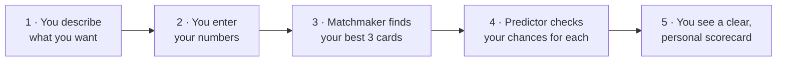

# How It Works (Plain English)

This guide explains the Financial Decision Engine with no jargon assumed. If you
want the technical diagrams, see [ARCHITECTURE.md](ARCHITECTURE.md).

## The problem

Picking a credit card is confusing. There are hundreds of them, the marketing is
noisy, and banks don't tell you how they decide who gets approved. People often
apply blindly. A rejection doesn't just hurt; in Canada, every application can
put a "hard inquiry" on your credit report and nudge your score down.

**The goal of this project** is to replace guessing with clarity:

1. Show people the few cards that actually match what they care about.
2. Tell them, before they apply, roughly how likely they are to be approved.

That's the finance goal: help people make informed decisions and avoid wasted
applications. It's also the social goal: make an opaque process more transparent.

## The journey in five steps

1. **You describe what you want** in normal words: *"a travel card with no
   foreign transaction fees"*.
2. **You enter three numbers**: your credit score, your yearly income and your
   current debt.
3. **The Matchmaker** looks through the card library and picks the 3 best fits.
4. **The Predictor** estimates your approval chance for each of those 3 cards.
5. **You get a scorecard**: each card, why it matched, its fees, and your
   percentage chance, plus a few tips about what your numbers mean.

---

## Stage 1: The Matchmaker (finding your options)

**Analogy: a librarian who knows which words matter.**

Imagine a librarian who has read the back cover of every card. When you say
"travel card, no foreign fees", they don't just look for books containing the word
"card" (every book has that). They focus on the *unusual* words in your request,
like "travel" and "foreign", and find the covers where those words are important.

That is exactly what **TF-IDF** does:

- **TF (term frequency):** how much a card talks about a word.
- **IDF (inverse document frequency):** how rare that word is across all cards.
  Rare words like "lounge" or "groceries" are strong clues. Common words like
  "card" are weak clues.

Each card becomes a list of numbers (a *vector*) describing its important words.
Your search becomes one too. **Cosine similarity** then measures how closely your
list points in the same direction as each card's list. 100% would be a perfect
match; 0% means nothing in common.

A few small touches make it smarter:

- The word **"no"** is kept, because "no annual fee" means the opposite of "annual fee".
- **Plurals are merged**, so "fees" matches "fee" and "groceries" matches "grocery".
- **Two-word phrases** like "annual fee" are also counted, not just single words.
- If nothing matches well, you get a friendly *"try words like travel or cash
  back"* message instead of random cards.

**Why it matters:** fewer, better choices. You see three relevant cards instead of
being overwhelmed by twenty.

---

## Stage 2: The Predictor (checking your chances)

**Analogy: an experienced loan officer who has seen thousands of applications.**

A loan officer who has reviewed thousands of applications develops a feel for
which combinations of credit score, income and debt usually get approved. Our
Predictor is a small **neural network** that learned those patterns from 5,000
example applications.

What it looks at, for each card:

| Number | Why it matters |
|---|---|
| **Credit score** (300–900) | Your track record of paying bills on time. |
| **Income** | Your ability to pay. |
| **Debt** | What you already owe. Debt *compared to* income is what lenders care about most. |
| **Card tier** (Starter → Elite) | Premium cards are harder to get than starter cards. |

How it turns those numbers into a percentage:

1. **Check the numbers are valid.** A credit score of 1,200 or a negative income
   is rejected with a clear message.
2. **Prepare the numbers.** Income and debt are put on a "log scale", because
   going from \$20k to \$40k changes your situation much more than going from
   \$220k to \$240k. Then everything is scaled so no single number dominates.
3. **Run the network.** The numbers flow through layers of simple math units
   ("neurons"). Each layer combines the previous layer's results, which lets the
   network learn rules like *"a low score is fine for a starter card but a deal
   breaker for an elite card"*.
4. **Turn the result into a percentage.** A final step called a **sigmoid**
   squashes the network's output into a number between 0 and 1, e.g. 0.84 = **84%**.
5. **Add a plain label:** High (70%+), Moderate (40–70%) or Low (under 40%).

Think of it like a weather forecast: "80% chance of rain" doesn't promise rain,
but it helps you decide whether to bring an umbrella. "84% approval odds" helps
you decide whether to apply.

### Where did the training examples come from?

Real approval data is private, so the project **creates realistic fake
applications** (called *synthetic data*). A hidden rulebook, similar in spirit to
how lenders think, decides each fake applicant's odds, and then a weighted coin
flip decides the outcome, so similar people sometimes get different answers, just
like real life. The network never sees the rulebook; it has to learn the patterns
from the examples alone.

We also train a simpler model (logistic regression) on the same data and compare
the two, to check that the neural network is actually adding value.

---

## Stage 3: How the pieces talk to each other

**Analogy: a restaurant.**

- **Streamlit (the dining room):** the web page you see. It takes your order
  (your search and numbers) and shows you the result. It never cooks.
- **FastAPI (the kitchen):** a separate server that receives the order as a
  structured message (JSON), runs both stages and sends back the finished plate.
- **SQLite (the pantry):** a small database file holding the 20 cards.
- **The model file (the recipe book):** the trained neural network, saved as
  `approval_mlp.pt` and loaded once when the kitchen opens, not once per order.

Keeping the dining room and kitchen separate is how real companies build
software: you can redesign the website without touching the ML, retrain the
model without touching the website, or let a mobile app use the same kitchen.

---

## What this project does **not** claim

- The cards and banks are **fictional**.
- The model is trained on **synthetic data**, so its percentages illustrate the
  technique; they are not real lender decisions.
- It is **not financial advice**. A real system would need real (and fairly
  sourced) data, bias testing across demographic groups, and regulatory review.
